# Student Grade Tracker

A containerised 3-tier web application for recording students and their grades, built with
Nginx, Node.js/Express and PostgreSQL. The project grew in three phases, reusing the same
application and images throughout:

| Phase | What it covers |
|---|---|
| 1. [Docker Compose](#quick-start) | Multi-stage images, Compose stack, health checks, Trivy scans |
| 2. [Kubernetes](#kubernetes-deployment) | Namespace, StatefulSet + PV/PVC, Deployments, Services on Minikube |
| 3. [CI/CD with Jenkins and ArgoCD](#cicd-with-jenkins-and-argocd) | Tested pipeline, GitOps deployment, rollback demo, evidence gallery |


## Architecture

```
 DELIVERY  (phase 3 · CI/CD)
 ┌───────────┐ git push ┌───────────────┐  poll  ┌─────────────────────────────────────────┐
 │ Developer │─────────▶│ GitHub (main) │◀──────▶│ Jenkins: test · build images · email    │
 └───────────┘          └───────┬───────┘        └─────────────────────────────────────────┘
                                │ ArgoCD watches k8s/ and syncs it
                                ▼
 RUNTIME  (phase 2 · Kubernetes on Minikube, namespace grade-tracker)
 ┌─────────┐   ┌──────────────────┐   ┌────────────────┐   ┌──────────────────┐   ┌────────────┐
 │ Browser │──▶│ frontend ×3      │──▶│ backend ×2     │──▶│ postgres         │──▶│ PVC → PV   │
 │         │   │ nginx :8080      │   │ Express :3000  │   │ StatefulSet 5432 │   │ (hostPath) │
 └─────────┘   └──────────────────┘   └────────────────┘   └──────────────────┘   └────────────┘
   Services: frontend-service (NodePort 30090) · backend (:3000) · postgres-service (:5432)

 phase 1 · Docker Compose: the same three images on one Docker network
   frontend :8080 ──▶ backend:3000 ──▶ db:5432 (named volume grade-tracker-db-data)
```

**Request path.** The browser only ever talks to the frontend. Nginx reverse-proxies `/api/`
to the backend by its service name (`backend:3000`), and the backend connects to PostgreSQL:
`db:5432` in Compose, `postgres-service:5432` in Kubernetes. Neither the backend nor the
database is reachable from outside its network.

**Delivery path.** Every push is tested by Jenkins. ArgoCD deploys whatever is in `k8s/` on
`main`, so deploying and rolling back are both Git commits. See
[CI/CD with Jenkins and ArgoCD](#cicd-with-jenkins-and-argocd).

Full design rationale: [docs/architecture.md](docs/architecture.md)


## Services

| Service  | Image                                                                                  | Port (host)      | Description                                                                |
|----------|------------------------------------------------------------------------------------------|--------------------|--------------------------------------------------------------------------------|
| frontend | `grade-tracker-frontend:0.1.0` (built from `nginxinc/nginx-unprivileged:1.27-alpine`)     | `8080:8080`        | Serves the static UI, reverse-proxies `/api` to backend, runs as non-root      |
| backend  | `grade-tracker-backend:0.1.0` (built from `node:20.15-alpine`, multi-stage)               | *(internal only)*  | Express REST API, connects to Postgres via `pg`, runs as non-root              |
| db       | `postgres:16.3-alpine` (official image)                                                   | *(internal only)*  | Stores students and grades, seeded from `database/init.sql`                    |

## Prerequisites

- Docker Engine 24+
- Docker Compose v2 (`docker compose`, not the legacy `docker-compose`)
- (Optional) [Trivy](https://aquasecurity.github.io/trivy/) for image scanning

## Quick Start

```bash
git clone https://github.com/Abdirahman-Maalim/student-grade-tracker.git
cd student-grade-tracker

# Create your local environment file
cp .env.example .env
# then edit .env and set POSTGRES_PASSWORD / DB_PASSWORD to a real value
# (POSTGRES_USER must match DB_USER, POSTGRES_PASSWORD must match DB_PASSWORD)

# Build and start the full stack
docker compose up --build
```

Once all three containers report `(healthy)` (`docker compose ps`), open the app in your browser.

- **Running Docker natively** (Docker Desktop on Mac/Windows/Linux): open `http://localhost:8080`
- **Running Docker inside a VM** (e.g. this project's Multipass Ubuntu VM): `localhost` refers to the VM itself, not your host machine's browser. Find the VM's IP first:
```bash
  ip addr show enp0s1 | grep "inet "
```
  Then open `http://<vm-ip>:8080` — for example `http://192.168.252.2:8080`.

## Usage

- **Add a student**: fill in name + email under "Add Student" and click **Add Student**.
- **Record a grade**: select a student, enter a subject and score (0–100), and click **Record Grade**.
- **Class Statistics** and the **All Grades** table update automatically, and auto-refresh every 30 seconds.
- Sample students/grades are seeded automatically from `database/init.sql` the first time the `db` volume is created.

## Automation Scripts

```bash
# Build and tag all custom images
./scripts/build.sh 0.1.0

# Verify the running stack is healthy
./scripts/healthcheck.sh
```

## Verifying Data Persistence

```bash
docker compose restart db
```

Refresh the app — previously added students/grades are still there, because Postgres data lives in the named volume `grade-tracker-db-data`, independent of the container's lifecycle.

## Vulnerability Scanning

Both custom-built images were scanned with [Trivy](https://aquasecurity.github.io/trivy/) (`--severity HIGH,CRITICAL`).

| Image                          | Alpine OS packages | App dependencies (`app/node_modules`) | HIGH | CRITICAL |
|----------------------------------|-----------------------|------------------------------------------|--------|------------|
| `grade-tracker-backend:0.1.0`  | 0 vulnerabilities     | 0 vulnerabilities                        | 12   | 0        |
| `grade-tracker-frontend:0.1.0` | 0 vulnerabilities     | n/a (no application dependencies)        | 0    | 0        |

**No CRITICAL vulnerabilities remain in either image.**

The 12 HIGH findings on the backend (e.g. `cross-spawn`, `glob`, `minimatch`, `tar`, `sigstore`) all live in `usr/local/lib/node_modules/npm/...` — the **npm CLI bundled inside the `node:20.15-alpine` base image itself**, not in code the application imports or executes. The application's own three dependencies (`express`, `pg`, `cors`) scanned completely clean. Since the final image is built via a multi-stage Dockerfile and only needs the Node.js *runtime* (not the `npm` CLI) to execute `node src/server.js`, these findings can be eliminated entirely by removing the bundled npm binary from the final stage — noted as a follow-up hardening step.

Full scan reports are saved under [`docs/scans/`](docs/scans/):
- `backend-vuln-scan.txt` — initial backend scan
- `backend-vuln-scan-rescan.txt` — backend re-scan
- `frontend-vuln-scan.txt` — initial frontend scan
- `frontend-vuln-scan-rescan.txt` — frontend re-scan

To re-run the scans yourself:

```bash
trivy image --severity HIGH,CRITICAL grade-tracker-backend:0.1.0
trivy image --severity HIGH,CRITICAL grade-tracker-frontend:0.1.0
```

## Pushing Images to Docker Hub

```bash
docker login

docker tag grade-tracker-backend:0.1.0  hub.docker.com/repository/docker/abdirahmankhalif/grade-tracker-backend:0.1.0
docker tag grade-tracker-frontend:0.1.0 hub.docker.com/repository/docker/abdirahmankhalif/grade-tracker-frontend:0.1.0

docker push hub.docker.com/repository/docker/abdirahmankhalif/grade-tracker-backend:0.1.0
docker push hub.docker.com/repository/docker/abdirahmankhalif/grade-tracker-frontend:0.1.0
```

## Troubleshooting

| Symptom                                                                              | Likely cause / fix                                                                                                                                                                                                                                                                                                                          |
|-----------------------------------------------------------------------------------------|--------------------------------------------------------------------------------------------------------------------------------------------------------------------------------------------------------------------------------------------------------------------------------------------------------------------------------------------------|
| Backend image builds but has no `HEALTHCHECK`, no non-root user, no app code             | The Dockerfile only had Stage 1 (`deps`) written when `docker build` ran — Stage 2 (`runtime`) was added to the file *after* the build. Confirm both stages exist with `cat Dockerfile` (look for two `FROM` lines), then rebuild with `docker build -t grade-tracker-backend:0.1.0 .` (run from inside the `backend/` directory) — Docker will re-run every instruction now present in the file. |
| Backend fails to authenticate against Postgres / crash-loops even though `.env` "looks right" | `.env` had **duplicate variable definitions** (e.g. a leftover placeholder block below the real one) — in a `.env` file, the *last* definition of a variable wins, so `DB_HOST=database` or `DB_PASSWORD=your_secure_password` silently overrode the correct values set earlier in the same file. Run `cat .env` and checked for the same variable name appearing more than once; deleted the duplicate block and re-run `docker compose config` to confirm the resolved values are correct before starting the stack. |
| Frontend briefly shows `0` students / `0` grades right after `docker compose restart db` | The page happened to load (or auto-refresh) during the few seconds `db` was restarting, so the `fetch()` calls in `index.html` failed silently and fell back to their default `0`/`—` placeholders. This is a transient UI read, not data loss — confirm the real state directly against Postgres: `docker compose exec db psql -U admin -d grades_db -c "SELECT * FROM students;"`, then refresh the browser once `docker compose ps` shows `db` and `backend` both `(healthy)` again. |

## Clean Rebuild (From Scratch)

```bash
docker compose down -v
docker compose up --build
```
---

## Kubernetes Deployment

This project also ships as a Kubernetes deployment (`k8s/`), reusing the
same Docker Hub images built during the Docker Compose phase - no
application code changes were needed.

### Kubernetes Resources

| Kind | Name | Purpose |
|---|---|---|
| Namespace | `grade-tracker` | Isolates all resources for this app |
| ConfigMap | `grade-tracker-config` | Non-sensitive app config (DB host/port/name/user, API port) |
| ConfigMap | `postgres-initdb` | Holds `init.sql` content, mounted into Postgres on first start |
| PersistentVolume | `grade-tracker-postgres-pv` | 2Gi hostPath storage for the database |
| PersistentVolumeClaim | `grade-tracker-postgres-pvc` | 1Gi claim bound to the PV above |
| StatefulSet | `postgres` | Single-replica PostgreSQL 15 instance |
| Service (Headless) | `postgres-headless` | Stable per-Pod DNS for the StatefulSet |
| Service (ClusterIP) | `postgres-service` | Internal DB endpoint used by the backend |
| Deployment | `backend-deployment` | 2 replicas of the Express API |
| Service (ClusterIP) | `backend` | Internal API endpoint (name required by the frontend's built-in nginx proxy) |
| Deployment | `frontend-deployment` | 2 replicas of the Nginx-served UI |
| Service (NodePort) | `frontend-service` | External access on port 30090 |

### Prerequisites

- Minikube
- kubectl
- Docker (for Minikube's driver)

### Deployment Order

```bash
cd k8s
kubectl apply -f namespace.yaml
kubectl apply -f configmap.yaml
kubectl apply -f persistentvolume.yaml
kubectl apply -f persistentvolumeclaim.yaml
kubectl apply -f postgres-headless-service.yaml
kubectl apply -f postgres-service.yaml
kubectl apply -f postgres-statefulset.yaml
kubectl apply -f backend-service.yaml
kubectl apply -f backend-deployment.yaml
kubectl apply -f frontend-service.yaml
kubectl apply -f frontend-deployment.yaml
```

Full step-by-step reasoning for this order, plus the ReplicaSet exercise
(applied and deleted separately, before the backend Deployment), is in
[docs/architecture.md](docs/architecture.md).

### Accessing the Application

```bash
minikube service frontend-service -n grade-tracker --url
```

Open the printed URL in your browser.

### Verifying Everything Is Healthy

```bash
kubectl get all -n grade-tracker
kubectl get pv,pvc -n grade-tracker
kubectl get endpoints -n grade-tracker
```

All Pods should show `Running`, the PVC should show `Bound`, and every
Service should have real Pod IPs listed under its endpoints (not `<none>`).

### Verifying Data Persistence

```bash
kubectl delete pod postgres-0 -n grade-tracker
kubectl get pods -n grade-tracker -w
```

Reload the app once `postgres-0` is `Running` again - previously added
students and grades should still be present, since they live in the PVC,
not the Pod.

### Cleaning Up

```bash
kubectl delete namespace grade-tracker
```

Deletes every resource created in this section in one command. The
PersistentVolume itself (`grade-tracker-postgres-pv`) is cluster-scoped,
not namespaced, so it survives this and would need
`kubectl delete pv grade-tracker-postgres-pv` separately if you want to
remove it too - its `Retain` reclaim policy means the underlying data on
disk is preserved either way.

### Kubernetes-Specific Troubleshooting

| Symptom | Likely cause / fix |
|---|---|
| StatefulSet rejected with `spec.updateStrategy: Invalid value` | StatefulSets only accept `RollingUpdate` or `OnDelete` for `updateStrategy.type` - `Recreate` (valid on Deployments) is not valid here. |
| Pod stuck in `ImagePullBackOff` with "no space left on device" in `kubectl describe pod` | Minikube's internal disk is full. Run `minikube ssh -- docker system prune -a -f`, and if that's insufficient, resize the underlying VM's disk and restart Minikube. |
| `kubectl` suddenly returns "no route to host" on port 8443 | Minikube's internal cluster stopped (often after the host VM was stopped/restarted) and needs to be brought back up explicitly with `minikube start` - it does not restart automatically with the host. |
| Frontend loads but API calls fail | Confirm the backend Service is named exactly `backend` - the frontend's built-in `nginx.conf` has this hostname hardcoded and cannot be changed without rebuilding the image. |


## CI/CD with Jenkins and ArgoCD

The Kubernetes deployment above started out as manual `kubectl apply` commands. It now runs
as a Git-driven delivery workflow:

- **Jenkins (CI)** checks every push: install, test, optionally build Docker images, archive, and email the result.
- **ArgoCD (CD)** watches `k8s/` on `main` and keeps the cluster identical to it.
- **Git is the single source of truth.** Deploying is a commit, and rolling back is a `git revert`.
  Nobody runs `kubectl apply` for this app any more.

The existing application code and manifests were reused unchanged; the pipeline was built around them.

### Pipeline in detail

```
 Developer (VS Code)
        │ git push
        ▼
 GitHub · main ─────────────────────────────────┬──────────────────────────────┐
        │ Poll SCM every 2 min                  │                              │ ArgoCD polls ~3 min
        ▼                                       ▲                              ▼
 ┌─ Jenkins (CI) ───────────────────────┐       │     ┌─ ArgoCD (CD, in-cluster) ───────────┐
 │ Checkout  commit SHA + image tag     │       │     │ App: student-grade-tracker          │
 │ Install   npm install (backend)      │       │     │ source: main:/k8s                   │
 │ Test      18 tests, JUnit report     │       │     │ auto-sync · prune · selfHeal        │
 │ Docker    build images (optional)    │       │     └──────────────────┬──────────────────┘
 │ Publish   push + commit new tags ────┼───────┘                        │ apply / reconcile
 │ Archive   build-info + tarball       │                                ▼
 │ post      email the result           │           Minikube · namespace grade-tracker
 └──────────────────────────────────────┘           postgres · backend ×2 · frontend ×3
```

Jenkins never talks to the cluster; its only way to change what runs is a Git commit.
**CI decides whether a change is good. CD makes the cluster match Git.**

### Evidence

Click any thumbnail to open the full-size screenshot.

| | | |
|:---:|:---:|:---:|
| <a href="docs/screenshots/01-jenkins-success.png">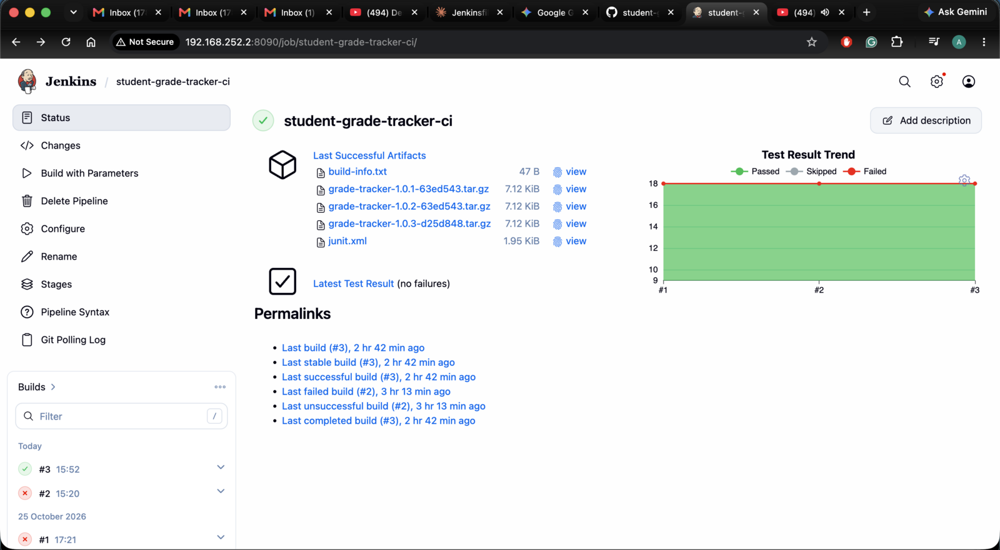</a><br><sub>**1 · CI passing:** 18/18 tests, artifacts archived</sub> | <a href="docs/screenshots/02-jenkins-failure-and-fix.png">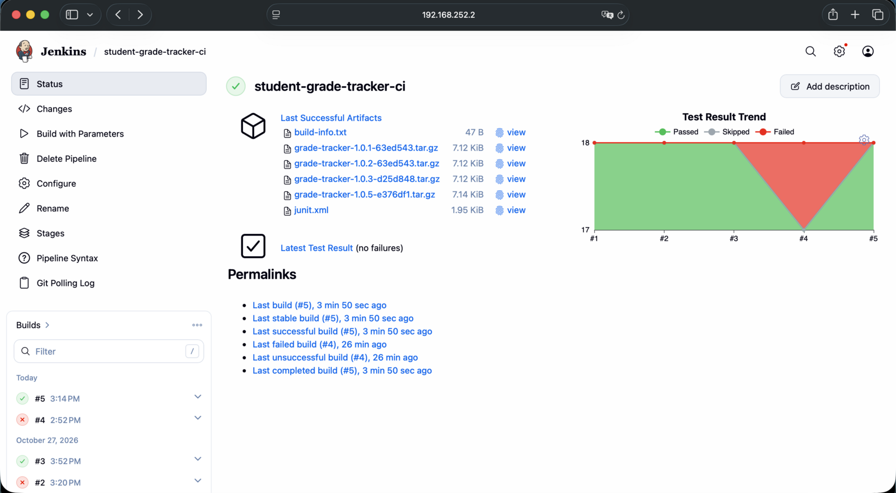</a><br><sub>**2 · CI gate:** deliberate failure in #4, fixed in #5</sub> | <a href="docs/screenshots/03-argocd-synced.png">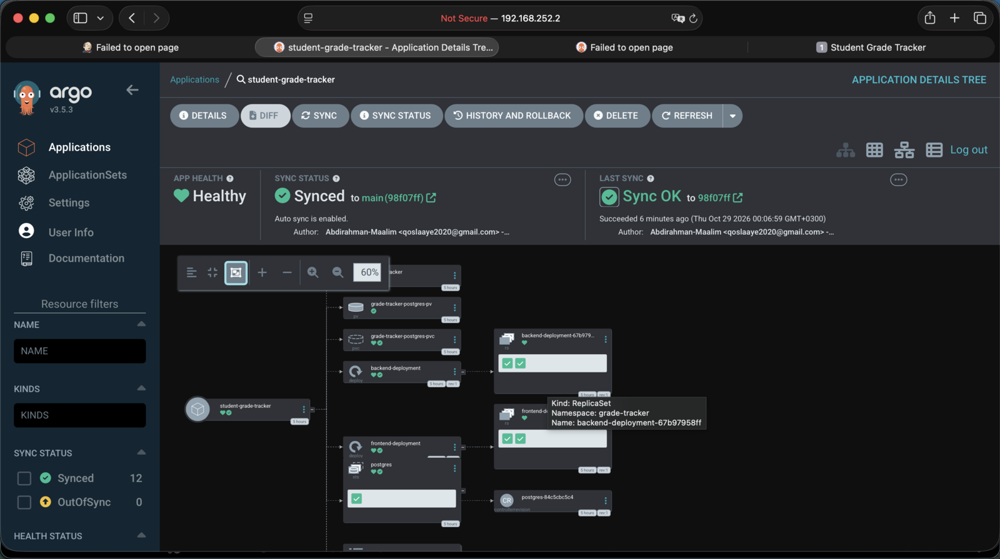</a><br><sub>**3 · CD:** ArgoCD Synced and Healthy</sub> |
| <a href="docs/screenshots/03b-app-running.png">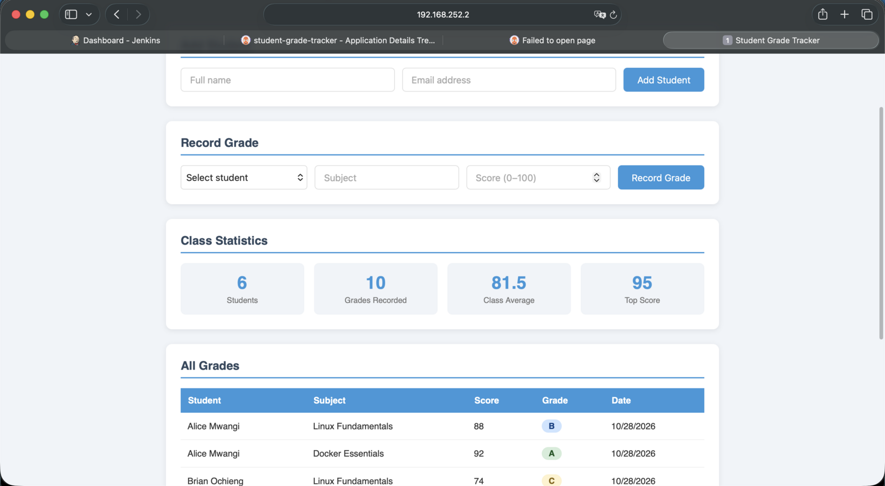</a><br><sub>**4 · App:** data served from PostgreSQL in the cluster</sub> | <a href="docs/screenshots/04b-argocd-three-replicas.png">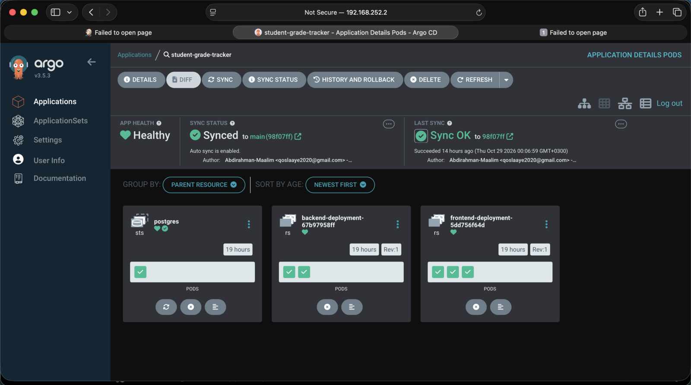</a><br><sub>**5 · GitOps update:** `replicas: 3` deployed from commit `98f07ff`</sub> | <a href="docs/screenshots/04c-argocd-automated-sync-detail.png">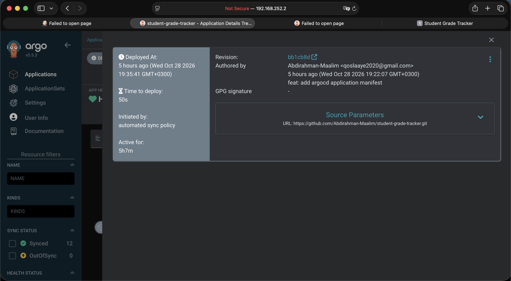</a><br><sub>**6 · Deployment record:** "Initiated by: automated sync policy"</sub> |
| <a href="docs/screenshots/06-argocd-broken-release.png">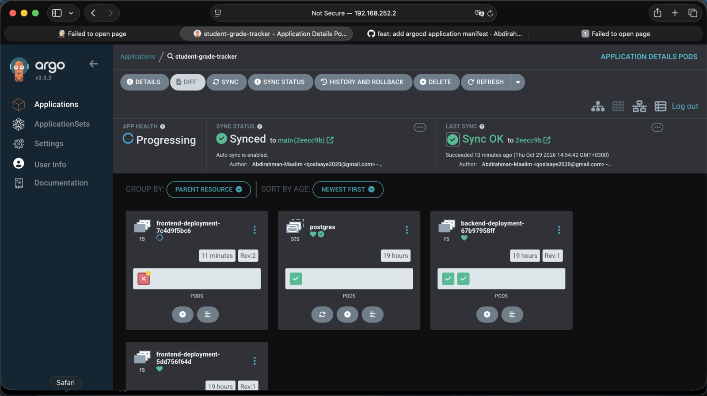</a><br><sub>**7 · Bad release:** failing pod, old pods keep serving</sub> | <a href="docs/screenshots/07-argocd-rollback-events.png">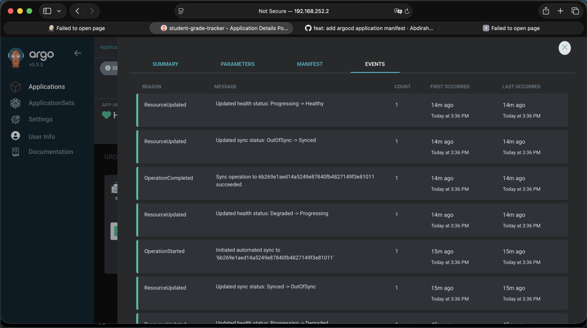</a><br><sub>**8 · Rollback:** Degraded → sync to revert → Healthy</sub> | <a href="docs/screenshots/07b-argocd-rolled-back-rev3.png">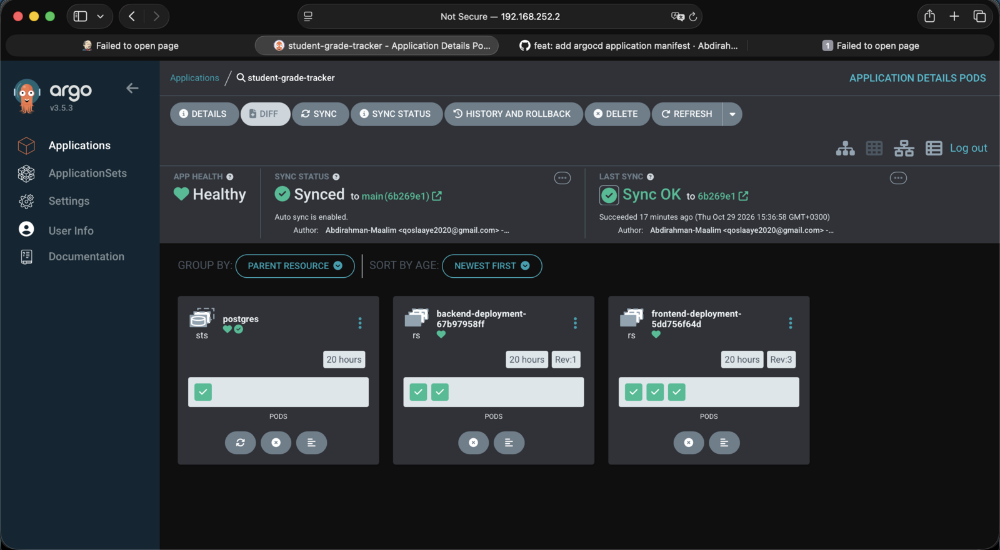</a><br><sub>**9 · Recovered:** synced to `6b269e1`, ReplicaSet Rev:3</sub> |
| <a href="docs/screenshots/08-jenkins-docker-build.png">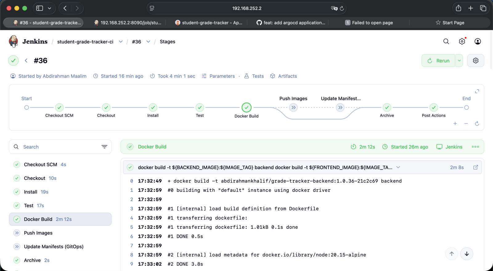</a><br><sub>**10 · Docker Build stage** (build #36)</sub> | <a href="docs/screenshots/08b-docker-images.png">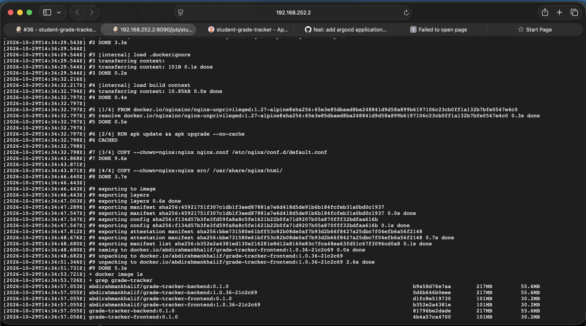</a><br><sub>**11 · Images** tagged `1.0.36-21c2c69` (build + commit)</sub> | |

<details>
<summary><b>Files added for CI/CD</b></summary>

| File | Purpose |
|---|---|
| `Jenkinsfile` | Declarative pipeline (repo root): stages, Poll SCM trigger, email notification |
| `package.json` | Defines `npm test` with Node's built-in test runner (no extra dependencies) |
| `tests/site.test.js` | Frontend: page title, relative `/api` calls, nginx port 8080, `proxy_pass` to `backend:3000`, `/healthz` |
| `tests/backend.test.js` | API: syntax check, dependencies, `/health` and `/api/*` routes, DB settings from env vars |
| `tests/k8s.test.js` | Manifest wiring: Service names and ports line up, DB host/port, no `:latest` images |
| `argocd/application.yaml` | ArgoCD Application pointing at `main:/k8s` |

The tests only read files, so they run in seconds with no database or cluster. `k8s.test.js`
exists because a manifest can be valid YAML and still break the app; for example, renaming the
`backend` Service breaks the frontend's hard-coded nginx proxy.

</details>

<details>
<summary><b>Prerequisites, tests and Jenkins setup</b></summary>

**Prerequisites**
- Ubuntu VM with Minikube (Docker driver) and `kubectl`
- Jenkins LTS (here on port 8090) with Node.js 20.11+, `git`, and the `jenkins` user in the `docker` group
- Jenkins plugins: Pipeline, Git, JUnit, Credentials Binding, Timestamper, Mailer
- ArgoCD in the `argocd` namespace

**Run the tests locally**
```bash
npm test          # 18 tests; JUnit XML in reports/junit.xml
```

**Jenkins job**
1. **New Item** → `student-grade-tracker-ci` → **Pipeline**.
2. **Pipeline script from SCM** → Git → this repo, branch `*/main`, script path `Jenkinsfile`.
   The repo is public, so no credentials are needed to read it.
3. Trigger: the Jenkinsfile declares `pollSCM('H/2 * * * *')`. The VM is on a private network
   GitHub can't reach, so polling replaces a webhook.
4. Email: **Manage Jenkins → System**: Gmail SMTP (`smtp.gmail.com:465`, SSL) with an
   **App Password**, plus a global environment variable `NOTIFY_EMAIL`. The address and
   credentials live in Jenkins, not in this public repo.

**Triggering**
- **Automatic:** push to `main`. Within about 2 minutes the build shows *"Started by an SCM change"*.
- **Manual:** **Build with Parameters**
  - `BUILD_IMAGES`: build the backend and frontend images
  - `PUBLISH`: push the images and commit the new tags to `k8s/` (needs `dockerhub-creds` and `github-creds`)

| Stage | What it does | Why |
|---|---|---|
| Checkout | Clones the commit; `IMAGE_TAG = 1.0.<build>-<sha>` | Every image traces to one build and one commit |
| Install | `npm install` in `backend/` | Proves dependencies resolve |
| Test | `npm test`; JUnit published even on failure | The quality gate: a failure stops all later stages |
| Docker Build | Builds both images from the existing Dockerfiles | Only tested code becomes an image |
| Push / Update Manifests | Pushes images; updates image tags in `k8s/`; commits with `[skip ci]` | Jenkins changes Git, never the cluster; `[skip ci]` prevents a build loop |
| Archive | `build-info.txt` + tarball | An immutable record of what each build contained |
| post | Prunes old images; emails result, author, commit and links | Fast feedback without watching a dashboard |

</details>

<details>
<summary><b>ArgoCD setup and how sync works</b></summary>

```bash
kubectl apply -n argocd -f argocd/application.yaml     # the only manual apply, done once
kubectl -n argocd get application student-grade-tracker
```

- `path: k8s`, `targetRevision: main`: ArgoCD deploys exactly this folder.
- `directory.exclude: replicaset-exercise.yaml`: the lab ReplicaSet's pods carry `app: backend`,
  so the `backend` Service would also send traffic to them. The file stays in Git as a record
  of the exercise but is not deployed.
- `automated` with `prune` and `selfHeal`: commits deploy automatically, resources removed
  from Git are deleted, and manual `kubectl` changes are reverted.

**Sync cycle:** commit → ArgoCD fetches `main` (about every 3 minutes, or **Refresh**) →
**OutOfSync** → automated sync applies the difference → **Synced** → Kubernetes rolls it
out → **Progressing → Healthy** (or **Degraded**).

**Synced** means the cluster matches Git. **Healthy** means the result works. They are
different questions.

**Access from a laptop** (Minikube's node IP is only reachable from the VM):
```bash
kubectl -n argocd port-forward svc/argocd-server 8443:443 --address 0.0.0.0           # https://<vm-ip>:8443
kubectl -n grade-tracker port-forward svc/frontend-service 8085:80 --address 0.0.0.0  # http://<vm-ip>:8085
```

</details>

<details>
<summary><b>GitOps update and rollback demonstrations</b></summary>

**GitOps update.** Changed `replicas: 2 → 3` in `k8s/frontend-deployment.yaml` and committed
it (`98f07ff`). No `kubectl` was used: ArgoCD detected the commit and a third frontend pod
appeared. A manual `kubectl scale --replicas=5` was reverted to 3 by self-heal.

**Rollback.**
1. **Bad release:** `2eecc9b` set the frontend image to `9.9.9-broken`, a tag that doesn't exist.
   All 18 tests still passed, because static tests can't see the registry.
2. **Contained:** ArgoCD synced it. The new ReplicaSet's pod hit `ImagePullBackOff`, the rolling
   update stalled (`maxUnavailable` rounds down to 0 for 3 replicas), and the 3 existing pods kept
   serving. The app stayed up while health went Progressing → Degraded.
3. **Rolled back:** `git revert HEAD` produced `6b269e1`. ArgoCD synced it, Kubernetes scaled
   the broken ReplicaSet to 0, and the original ReplicaSet became revision 3. **No pod was
   restarted** at any point.

ArgoCD's Rollback button is disabled while auto-sync is on, because the next sync would
re-apply what Git says. In GitOps the lasting fix is a commit; a UI rollback is only a
temporary override that needs auto-sync disabled first.

```bash
kubectl -n grade-tracker get rs -l app=frontend \
  -o custom-columns='RS:.metadata.name,REVISION:.metadata.annotations.deployment\.kubernetes\.io/revision,IMAGE:.spec.template.spec.containers[0].image,PODS:.status.replicas'
```

</details>

<details>
<summary><b>Commit milestones</b></summary>

| Commit | Milestone |
|---|---|
| `f8a4427` | CI test suite |
| `63ed543` | Jenkinsfile: checkout, install, test, archive |
| `63d16f0` | Fix: archive tolerates a missing `argocd/` directory |
| `d25d848` | Poll SCM trigger defined in the Jenkinsfile |
| `f77b961` / `e376df1` | Deliberate test failure, then the fix |
| `4ab01e8` | Fix: clean `dist/` so artifacts belong to one build |
| `1e070d0` / `104e5f9` | Email notification, then the missing-brace fix |
| `bb1cb8d` | ArgoCD Application manifest |
| `98f07ff` | GitOps update: frontend to 3 replicas |
| `2eecc9b` / `6b269e1` | Broken release, then `git revert` rollback |

</details>

<details>
<summary><b>CI/CD troubleshooting (real incidents from this project)</b></summary>

| Symptom | Cause | Fix |
|---|---|---|
| Archive failed: `tar: argocd: Cannot stat` | Archive packed `argocd/` before it was committed | Include it only if present: `$(test -d argocd && echo argocd)` |
| Rebuild still showed the old error | **Restart from Stage** replays the old commit and Jenkinsfile; the fix wasn't pushed yet | `git push`, then **Build with Parameters** |
| Pushes never triggered builds | Poll SCM was ticked with an empty schedule ("only post-commit hooks") | `H/2 * * * *`, also declared in the Jenkinsfile |
| Old tarballs in "Last Successful Artifacts" | The workspace is reused between builds | `rm -rf dist && mkdir -p dist` before archiving |
| `expecting '}', found ''` before any stage ran | The pipeline's closing brace was lost while replacing the `post` block | Restored the brace; brace counts checked before pushing |
| ArgoCD `ComparisonError … connection refused` / `DeadlineExceeded`, stuck OutOfSync | VM memory exhaustion (~1 GiB free, no swap): repo-server, controller and server failed their probes | Freed memory (stopped Jenkins temporarily, paused another app with its auto-sync disabled), relaxed probe timeouts, cleared the stuck operation, hard refresh |
| Postgres `ImagePullBackOff`, backend stuck `Init:0/1` | Slow network during the pull; the init container correctly waits for Postgres | Deleted the pods to retry immediately |
| UI showed 0 students while the API worked | The `kubectl port-forward` tunnel dropped under VM load | Tested each hop with `kubectl exec … wget`; ran the tunnel in a reconnect loop |

</details>

### Lessons learned

- **A pipeline is measured by what it stops.** The deliberate failure proved the Test stage blocks
  bad changes. The broken-image release showed the limit of static tests: they can't see the
  registry, and a check such as `docker manifest inspect` would close that gap.
- **Git as the source of truth changes how you operate.** Deploying, scaling and rolling back were
  all commits, and manual changes were undone by self-heal.
- **Synced is not Healthy.** ArgoCD faithfully deployed a broken release; health checks and the
  rolling update are what kept the app up.
- **Rolling updates make bad releases cheap.** The broken ReplicaSet never replaced a healthy pod,
  and the rollback reused the existing ReplicaSet with zero restarts.
- **Sensitive or environment-specific settings belong in the CI server, not the repo**
  (SMTP credentials, notification address, registry tokens).
- **Resource limits are real.** On a 6 GB VM, Jenkins, ArgoCD and several apps competed for memory,
  and the symptoms (probe failures, sync timeouts, dropped tunnels) appeared far from the cause.
  Debugging meant checking each layer: app → Kubernetes → ArgoCD → host.


## Author

Abdirahman Maalim (https://github.com/Abdirahman-Maalim/student-grade-tracker)  — Docker, Docker Compose, Kubernetes and CI/CD (Jenkins + ArgoCD) project
